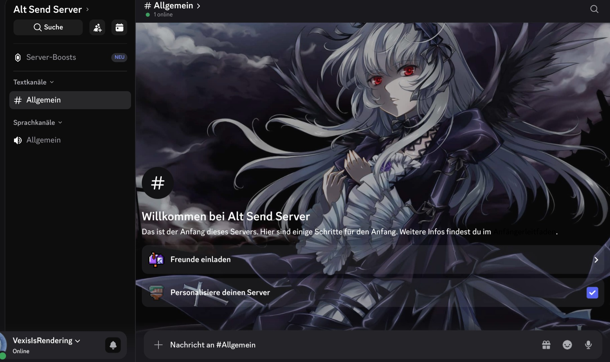

# Vermont Discord Theme 💜

A sleek, dark midnight purple theme designed for Discord mobile client loaders (such as Vendetta, Replugged, or Aliucord).

<p align="center">
  
</p>

---

## 🎨 Features

- **Obsidian Dark Scheme:** Deep dark base backgrounds (`#080808` and `#0D0D0D`) to reduce eye strain.
- **Vivid Purple Accents:** Vibrant purple accents (`#8400FF`) for highlights and buttons.
- **Enhanced Contrast:** High-visibility text colors tailored for reading clarity against dark overlays.
- **Custom Artwork:** Optimized background image opacity (`0.25`) to display artwork without distracting from active text channels.

---

## 🚀 Installation Guide

### Option 1: Direct Fetch Link (Recommended)

1. Open your modified Discord app on your device.
2. Navigate to **User Settings** $\rightarrow$ **Themes**.
3. Tap **Install Theme** or **Fetch Theme**.
4. Paste the raw theme URL below:

```
https://raw.githubusercontent.com/yymeowsy-bit/VexTheme/main/Vermont.json
```

5. Tap **Install** and select **Apply Theme**.

---

### Option 2: GitHub Pages Link

If your client loader supports GitHub Pages links, you can paste:

```
https://yymeowsy-bit.github.io/VexTheme/Vermont.json
```

---

## 🛠️ Customizing Background Visibility

To adjust how visible the background image is, open `Vermont.json` and change the `"alpha"` parameter under the `"background"` section:

```json
"background": {
  "url": "https://www.image2url.com/r2/default/images/1793504736205-46c3210e-9320-466b-9939-728fe2aeb21d.jpg",
  "alpha": 0.25,
  "size": "cover",
  "position": "center"
}
```

* **`0.15`** — Very faint / minimal background watermark.
* **`0.25`** — Balanced default (Recommended).
* **`0.35`** — High image visibility.

---

## 📄 License

Created by **vexis**. Free to use, modify, and share!
